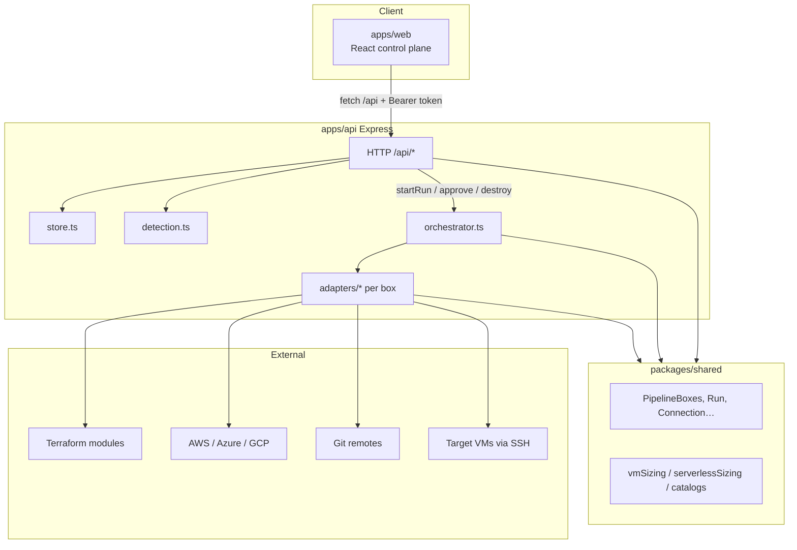
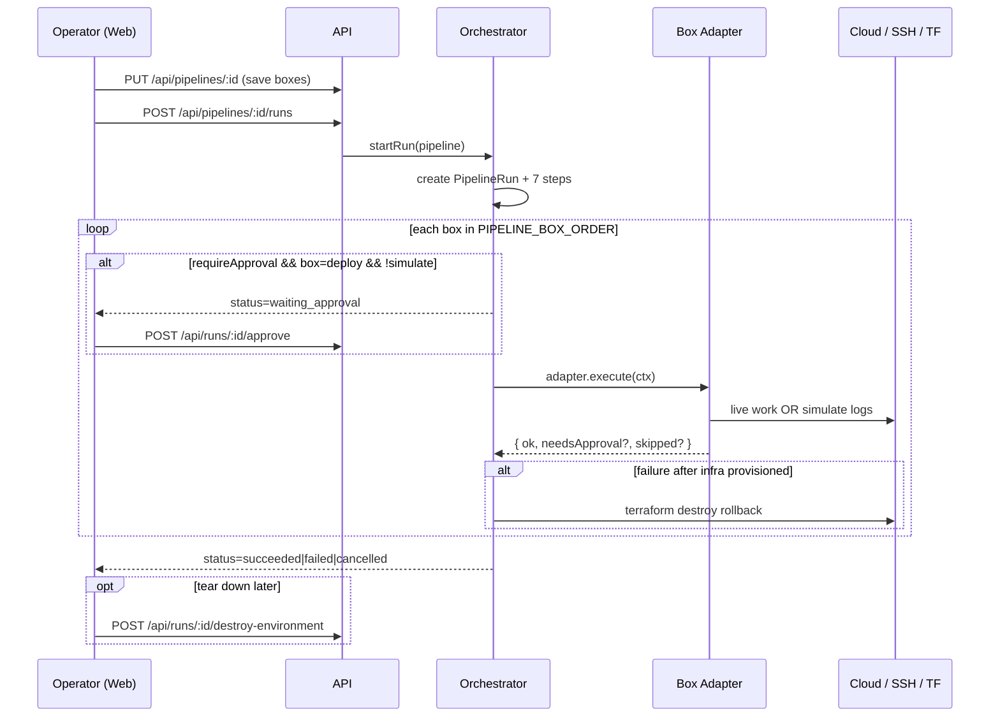
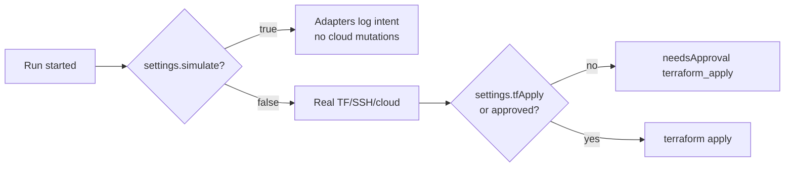
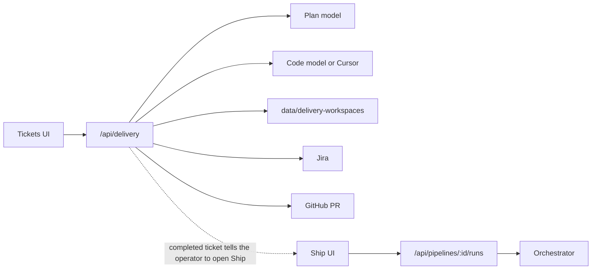
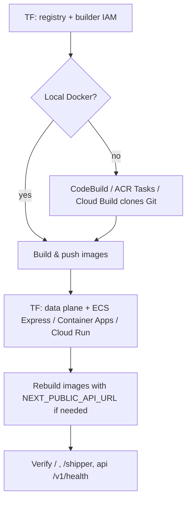
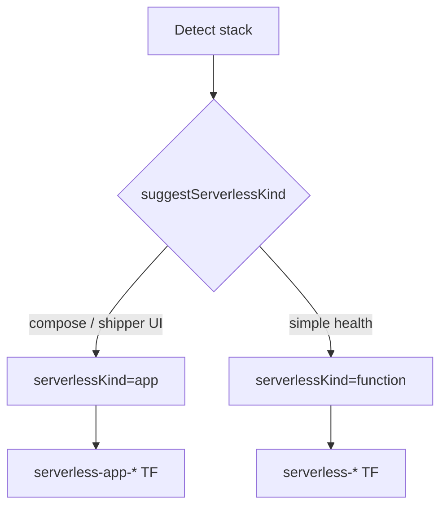
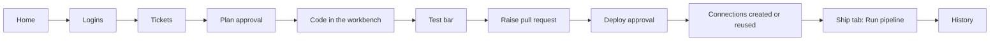
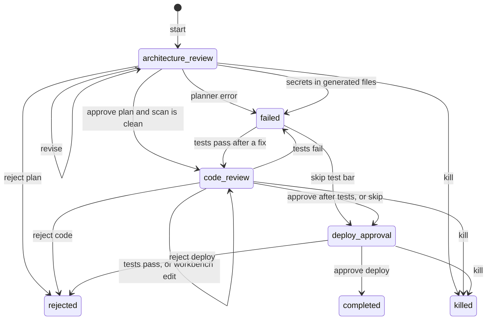

# Shipdeck (visual-devops-platform) — Complete Architecture & Rebuild Spec

> **Purpose:** This document is the single source of truth for understanding and **rebuilding** Shipdeck. Another engineer or LLM agent should be able to recreate the monorepo, the ticket-to-code process, the ship pipeline, APIs, Terraform paths, and UI from this file plus the referenced paths.
>
> **Product name:** Shipdeck  
> **Repo:** `visual-devops-platform`  
> **Tagline:** A Jira ticket becomes a live app. You approve each step.  
> **Operator path:** Logins → Ticket (plan, code, tests) → Ship (Source → Infra → Build → Data → Deploy → Verify → Notify)

---

## Table of contents

1. [What Shipdeck is](#1-what-shipdeck-is)
2. [Monorepo layout](#2-monorepo-layout)
3. [Tech stack](#3-tech-stack)
4. [System architecture](#4-system-architecture)
5. [Domain model (shared package)](#5-domain-model-shared-package)
6. [Pipeline execution engine](#6-pipeline-execution-engine)
7. [Box adapters (what each stage does)](#7-box-adapters-what-each-stage-does)
8. [Infra & Terraform modules](#8-infra--terraform-modules)
9. [Detection & sizing](#9-detection--sizing)
10. [HTTP API reference](#10-http-api-reference)
11. [Auth, roles, rate limits](#11-auth-roles-rate-limits)
12. [Persistence & secrets](#12-persistence--secrets)
13. [Web UI](#13-web-ui)
14. [Environment variables](#14-environment-variables)
15. [Local runbook](#15-local-runbook)
16. [Operator workflows](#16-operator-workflows)
17. [Gotchas & hard constraints](#17-gotchas--hard-constraints)
18. [Rebuild checklist for an agent](#18-rebuild-checklist-for-an-agent)
19. [File map (critical paths)](#19-file-map-critical-paths)
20. [Operator journey (the process)](#20-operator-journey-the-process)
21. [Delivery domain](#21-delivery-domain)
22. [Delivery state machine](#22-delivery-state-machine)
23. [Workbench, preview, and tests](#23-workbench-preview-and-tests)
24. [Delivery HTTP API](#24-delivery-http-api)
25. [Models, evidence, and sandbox](#25-models-evidence-and-sandbox)
26. [What deploy approval does and does not do](#26-what-deploy-approval-does-and-does-not-do)

---

## 1. What Shipdeck is

Shipdeck is a **ticket-to-live-app control plane** with two engines that stay separate until the operator joins them:

1. **Tickets (delivery).** A Jira issue, a pasted ticket, or the sample ticket `SHIP-1042` is planned into `architecture.md`, implemented in a local project folder, tested, and optionally opened as a GitHub pull request. The operator approves the plan, the code, and shipping. Simulate writes the folder with no model call and no cloud. Live calls a plan model and a code model.
2. **Ship (pipeline).** Seven boxes run in order: Source → Infra → Build → Data → Deploy → Verify → Notify. This is how a finished project folder, or any other app, actually reaches a VM or a serverless target. Simulate logs intent. Live runs Terraform, SSH, and cloud builders. After Create-infra succeeds, the pipeline run keeps an **environment** so the operator can **tear down** (DESTROY) later.

Home states the path in three beats: **Logins** (connect) → **Ticket** (develop and test) → **Ship** (deploy). History, and a Secrets screen that lists every saved login, sit beside those three.

It is **not** a general CI SaaS. The ticket engine builds a small Node app from an approved architecture (fixtures only). The ship engine is an opinionated cockpit for cloud VM / serverless function / full-app (containers + DB) paths. Deploy approval on a ticket **does not start the pipeline**. It saves connections and tells the operator to open Ship and run it.

---

## 2. Monorepo layout

```
visual-devops-platform/
├── package.json                 # workspaces: apps/*, packages/*
├── apps/
│   ├── api/                     # Express API + orchestrator + adapters (@shipdeck/api)
│   └── web/                     # React + Vite UI (@shipdeck/web)
├── packages/
│   └── shared/                  # Types, catalogs, sizing, defaults (@shipdeck/shared)
├── infra/
│   └── terraform/               # TF modules copied into per-run work dirs
│       ├── vm-aws|azure|gcp/
│       ├── serverless-aws|azure|gcp/          # Health function
│       ├── serverless-app-aws|azure|gcp/      # Full app UI
│       ├── db-aws-rds|db-azure-postgres|db-gcp-sql/
│       ├── cloud-init-docker.sh
│       └── README-serverless-app.md
├── deploy/
│   └── nginx.conf               # Compose web→api reverse proxy
├── data/                        # Runtime store (gitignored typically)
│   ├── store.json               # projects, pipelines, connections, pipeline runs, users
│   ├── settings.json
│   ├── secrets.enc              # connection secrets
│   ├── delivery.json            # delivery policy + delivery runs + webhook ids
│   ├── delivery-secrets.enc     # plan/code/jira/git keys + per-run existing-target secrets
│   ├── delivery-workspaces/<runId>/   # generated project (architecture.md, src, tests)
│   ├── delivery-attachments/    # pending/<TICKET>/ then <runId>/
│   ├── audit.jsonl              # append-only audit (JSON mode)
│   └── .secrets-key             # auto-generated key if SHIPDECK_SECRETS_KEY unset
├── examples/demo-app/           # Seeded demo localPath for new projects
├── .shipdeck-work/              # Per-run workspaces (git clone, TF dirs) — ephemeral
├── .github/workflows/ci.yml     # Build + test on push/PR
├── docker-compose.yml           # api + web(nginx) + optional postgres
├── Dockerfile                   # multi-stage: deps → build → api | web
├── README.md
└── ARCHITECTURE.md              # This file
```

### Root scripts (`package.json`)

| Script | Command |
|--------|---------|
| `dev:api` | `npm run dev -w @shipdeck/api` → `tsx watch src/index.ts` |
| `dev:web` | `npm run dev -w @shipdeck/web` → Vite `:5173` |
| `build` | shared → api → web |
| `start:api` | `node dist/index.js` in api |
| `test` | api `tsx --test src/**/*.test.ts` |

Workspaces: `"apps/*"`, `"packages/*"`.

---

## 3. Tech stack

| Layer | Choice |
|-------|--------|
| Language | TypeScript (ESM `"type": "module"`) |
| API | Express 4, Zod, nanoid, cors, ssh2, yaml, pg |
| UI | React 19, Vite 6, plain CSS (no UI kit) |
| Shared | Pure TS types + sizing/catalog helpers |
| IaC | Terraform modules under `infra/terraform/*` (AWS provider **≥ 6.34** for ECS Express) |
| Runtime | Node **22** (CI + Docker images) |
| Cloud builders | AWS CodeBuild, Azure ACR Tasks, GCP Cloud Build (full-app path) |
| Secrets | AES-256-GCM `data/secrets.enc` (key from `SHIPDECK_SECRETS_KEY` or `data/.secrets-key`) |
| Optional DB | PostgreSQL via `DATABASE_URL` |
| Packaging | Root `Dockerfile` + `docker-compose.yml`; web served via nginx (`deploy/nginx.conf`) |

**Ports**

| Service | Default |
|---------|---------|
| API | `PORT` or **4000** |
| Web (Vite dev) | **5173**, proxies `/api` → `http://localhost:4000` |
| Compose UI | **8088** (nginx → static web + `/api` proxy) |
| Demo app example | **8080** (`examples/demo-app` health) |

---

## 4. System architecture

### 4.1 High-level



### 4.2 Request → run lifecycle



### 4.3 Simulate vs Live



Defaults (see §14):

- `simulate = true` unless `SHIPDECK_SIMULATE=false`
- `tfApply = false` unless `SHIPDECK_TF_APPLY=true`
- `requireApprovalForTf = true` by default (must approve TF unless setting flipped)

### 4.4 Ticket engine beside the pipeline

The delivery service is a second engine in the same API process. It does not sit inside the seven-box loop.



Full gates, workbench kinds, and routes are §20–§26. Practice / Real cloud is one `settings.simulate` flag shared by both engines.

---

## 5. Domain model (shared package)

**Package:** `@shipdeck/shared`  
**Entry:** `packages/shared/src/index.ts`  
**Also exports:** `connections.ts` (build vs deploy folders), `delivery.ts`, `modelProviders.ts`, `vmSizing.ts`, `serverlessSizing.ts`, `serverlessKind.ts`, `serverlessAppSkus.ts`, `serverlessComputeCatalog.ts`, `vmCatalog.ts`

### 5.1 Pipeline box order (immutable product order)

```ts
PIPELINE_BOX_ORDER = [
  "source", "infra", "build", "data", "deploy", "verify", "notify"
]
```

> Note: **Data runs before Deploy** in this product.

### 5.2 Core types (rebuild these exactly)

```ts
type PipelineBoxType =
  | "source" | "infra" | "build" | "deploy" | "data" | "verify" | "notify";

type ConnectionType =
  | "git" | "jira" | "model"
  | "ssh" | "azure" | "aws" | "gcp"
  | "docker" | "registry" | "kubernetes" | "notify";

type ConnectionFolder = "build" | "deploy";
// build:  jira, git, model     — used while planning and writing the ticket
// deploy: ssh, aws, azure, gcp, docker, registry, kubernetes, notify — used when shipping

type RunStatus =
  | "queued" | "running" | "waiting_approval"
  | "succeeded" | "failed" | "cancelled";

type StepStatus =
  | "pending" | "running" | "succeeded" | "failed"
  | "skipped" | "waiting_approval";

type DeployRuntime = "docker" | "compose" | "systemd" | "kubernetes";
type InfraMode = "existing" | "create" | "skip";
type InfraComputeMode = "vm" | "serverless";
type ServerlessKind = "function" | "app";  // health JSON vs full UI
type ServerlessRuntime = "nodejs20" | "python312";
type UserRole = "admin" | "operator" | "viewer";
```

### 5.3 `PipelineBoxes` shape

| Box | Config interface | Key fields |
|-----|------------------|------------|
| **source** | `SourceBoxConfig` | `mode: local\|remote`, `localPath?`, `branch`, `gitConnectionId?` |
| **infra** | `InfraBoxConfig` | `mode`, `computeMode?`, `sshConnectionId?`, `cloudConnectionId?`, `cloudProvider?`, `region?`, `vmSize?`, `serverlessKind?`, `serverlessMemoryMb?`, `serverlessTimeoutSeconds?`, `serverlessRuntime?` |
| **build** | `BuildBoxConfig` | `runTests`, `dockerfilePath?`, `registryConnectionId?`, `imageName?`, `testChoice?`, `dockerfileChoice?` |
| **deploy** | `DeployBoxConfig` | `runtime`, `port`, `healthPath`, `envVars`, `composeChoice?`, `domain?` |
| **data** | `DataBoxConfig` | `enabled`, `engine?`, `provisionMode?`, `createWithTerraform`, `connectionStringEnv?` |
| **verify** | `VerifyBoxConfig` | `healthUrl?`, `timeoutSeconds`, `autoRollback` |
| **notify** | `NotifyBoxConfig` | `enabled`, `notifyConnectionId?` |

### 5.4 Entities

- **Project** `{ id, name, description?, defaultPipelineId?, createdAt }`
- **Pipeline** `{ id, name, projectId, boxes, createdAt, updatedAt }`
- **Connection** `{ id, name, type, config, hasSecrets, createdAt, updatedAt }` — secrets never returned in `config`
- **PipelineRun** `{ id, pipelineId, projectId, status, steps[], createdAt, startedAt?, finishedAt?, detection?, environment? }`
- **RunStep** `{ id, box, name, status, logs[], startedAt?, finishedAt?, error? }`
- **RunEnvironment** — see §6.4
- **StackDetection** `{ stack, confidence, suggestedRuntime, signals[], compose?, vmSizing?, serverlessSizing? }`
- **PlatformSettings** `{ simulate, tfApply, requireApproval, requireApprovalForTf, authRequired, storage }`

### 5.5 Defaults (`createDefaultBoxes()`)

Important defaults:

- source: `mode: "local"`, `branch: "main"`
- infra: `mode: "existing"`, `computeMode: "vm"`, `cloudProvider: "azure"`, `region: "eastus"`, `vmSize: "Standard_B2s"`, serverless defaults 512MB / 30s / nodejs20
- Seeded project localPath often points at `examples/demo-app`

---

## 6. Pipeline execution engine

**Files:**

- `apps/api/src/orchestrator.ts` — start / continue / cancel / approve / reject / reclaim
- `apps/api/src/adapters/index.ts` — box adapters
- `apps/api/src/runtime/context.ts` — in-memory per-run outputs (`tfWorkDir`, IPs, URLs…)

### 6.1 `startRun(pipeline)`

1. Detect stack from boxes (local path or prior knowledge).
2. Create 7 `RunStep`s from `PIPELINE_BOX_ORDER` + `BOX_LABELS`.
3. Persist run `status: "queued"`.
4. Fire `continueRun(runId, pipeline, 0, {})` async (HTTP returns 201 immediately with run).

### 6.2 `continueRun` loop

For each step index `i`:

1. Honor cancel set.
2. If **Live** && `requireApproval` && box === `deploy` && not yet `preDeployApproved` → pause `waiting_approval` kind `pre_deploy`.
3. Find adapter by `box`, set step `running`, call `adapter.execute({ boxes, runId, simulate, terraformApplyApproved, log })`.
4. Handle result:
   - `needsApproval` → pause (`terraform_apply` or other `approvalKind`)
   - `skipped` / `ok` → mark step, attach environment after infra success
   - failure → mark failed; if infra provisioned → **rollback destroy**
5. On full success → `status: succeeded`.

### 6.3 Approval kinds

| Kind | When | Approve resumes |
|------|------|-----------------|
| `pre_deploy` | Setting requireApproval before deploy | Same step with `preDeployApproved` |
| `terraform_apply` | Adapter needs TF apply approval | Same step with `terraformApplyApproved` |

### 6.4 Run environment

When Infra Create provisions resources, orchestrator calls `attachEnvironmentFromOutputs`.

```ts
interface RunEnvironment {
  provisioned: boolean;
  status: "active" | "destroying" | "destroyed" | "destroy_failed";
  publicIp?: string;
  deployHost?: string;
  provider?: string;
  region?: string;
  cloudConnectionId?: string;
  sshConnectionId?: string;      // auto-created SSH conn for new VM
  tfWorkDir?: string;
  destroyedAt?: string;
  destroyError?: string;
  computeMode?: "vm" | "serverless";
  serverlessKind?: "function" | "app";
  serviceUrl?: string;           // serverless HTTPS endpoint
}
```

**Destroy:** `POST /api/runs/:id/destroy-environment` → `destroyRunEnvironment` → Terraform destroy with timeout **1_800_000 ms (30 minutes)** (`lib/infraDestroy.ts`). Empty Terraform state after a killed destroy is treated as **success**. Operator UI requires typing `DESTROY`. May also clear pipeline `sshConnectionId` if it pointed at the auto-created VM SSH connection.

### 6.5 Orphan reclaim

On API boot, `reclaimOrphanedRuns()` fails runs left `running`/`queued` when env already destroyed or a step already failed (process crash mid-run).

---

## 7. Box adapters (what each stage does)

**File:** `apps/api/src/adapters/index.ts`  
**Contract:**

```ts
interface AdapterContext {
  boxes: PipelineBoxes;
  runId: string;
  simulate: boolean;
  terraformApplyApproved?: boolean;
  log: (line: string) => void;
}
interface AdapterResult {
  ok: boolean;
  skipped?: boolean;
  needsApproval?: boolean;
  approvalKind?: string;
  message?: string;
}
```

Exported array order matches pipeline boxes: source, infra, build, data, deploy, verify, notify.

### 7.1 Source

- Resolve root via `resolveSourceRoot` (`lib/gitSource.ts`):
  - **local:** use `boxes.source.localPath`
  - **remote:** clone/fetch Git using `gitConnectionId` secrets into `.shipdeck-work/<id>/`
- Detect stack; store outputs for later steps.
- Simulate: log branch/path without requiring network if configured that way.

### 7.2 Infra

Modes:

| `infra.mode` | Behavior |
|--------------|----------|
| `skip` | Skipped |
| `existing` | Use `sshConnectionId` host; no TF create |
| `create` | Terraform from modules under `infra/terraform/*` |

Create branches:

| `computeMode` | `serverlessKind` | Module family |
|---------------|------------------|---------------|
| `vm` (default) | — | `vm-aws` / `vm-azure` / `vm-gcp` + cloud-init Docker |
| `serverless` | `function` | `serverless-aws` / `serverless-azure` / `serverless-gcp` (Lambda/Functions health JSON) |
| `serverless` | `app` | `serverless-app-aws` / `azure` / `gcp` (containers + managed DB/cache) |

Live create:

1. Copy TF module into run work dir.
2. Write tfvars from connection + sizing (no hardcoded SKUs baked into modules for app path — driven by detection/sizing helpers).
3. `terraform init/plan/apply` gated by `tfApply` / approval.
4. Capture outputs: public IP / `service_url` / registry URLs.
5. For VM: may auto-save SSH connection with Deploy PEM.
6. For serverless **app**: cloud image build (Docker local **or** CodeBuild / ACR Tasks / Cloud Build), then deploy services.

Supporting libs:

- `lib/serverlessInfra.ts`, `lib/serverlessAppDeploy.ts`, `lib/serverlessCloud.ts`, `lib/serverlessPackage.ts`
- `lib/awsJson.ts`, `lib/azureAcrBuild.ts`, `lib/gcpCloudBuild.ts`
- `lib/cloud.ts`, `lib/infraDestroy.ts`, `lib/runEnvironment.ts`

### 7.3 Build

- **Skipped entirely when Infra is serverless** (`computeMode=serverless`) — images/zips are produced in Infra/Deploy paths (cloud builders or package step), not the Build box.
- For VM / existing SSH paths: install / test / image build depending on stack and choices.
- `testChoice`: existing vs generated Shipdeck smoke tests (`lib/testReview.ts`).
- `dockerfileChoice`: existing vs `Dockerfile.shipdeck` (`lib/dockerfileReview.ts`).
- May push to registry connection.
- On Windows, local Jest for compose runtimes is often skipped; builds may run on the target VM at Deploy.

> **Trap:** `adapters` array in code may list deploy before data, but the orchestrator always executes **`PIPELINE_BOX_ORDER`** (data before deploy). Do not reorder adapters assuming array order is execution order.

### 7.4 Data

- If disabled → skip.
- Else dockerized DB and/or terraform managed DB modules (`db-aws-rds`, `db-azure-postgres`, `db-gcp-sql`).
- Serverless **app** path often provisions Aurora/Postgres + Redis as part of app modules rather than this box alone.

### 7.5 Deploy

- Runtimes: docker / compose / systemd / kubernetes.
- Compose path uses detection + optional generated compose (`lib/composeGenerate.ts`, `lib/composeDeployPrep.ts`).
- SSH deploy to VM or update serverless function/app code/images.
- May open cloud NSG / firewall ports (`lib/openPorts.ts`, `lib/azureNsg.ts`).

### 7.6 Verify

- HTTP health check against `verify.healthUrl` or inferred URL.
- Compose-aware helpers prefer API `/v1/health` or UI `/` / `/shipper`.
- `autoRollback` can trigger infra destroy on failure.

### 7.7 Notify

- If enabled, post to notify connection endpoint/webhook.

---

## 8. Infra & Terraform modules

**Root:** `infra/terraform/`

| Directory | Use |
|-----------|-----|
| `vm-aws`, `vm-azure`, `vm-gcp` | Classic Create VM + networking + cloud-init |
| `cloud-init-docker.sh` | Bootstraps Docker on new VMs |
| `serverless-aws\|azure\|gcp` | Health **function** (zip / managed function HTTP) |
| `serverless-app-aws` | ECR + **ECS Express Mode** + Aurora Serverless + ElastiCache Serverless + CodeBuild |
| `serverless-app-azure` | ACR + Container Apps + Flexible Postgres + Redis + ACR Tasks |
| `serverless-app-gcp` | Artifact Registry + Cloud Run + Cloud SQL + Memorystore + Cloud Build |
| `db-*` | Standalone managed DB modules for Data box |

### Full-app operator requirements (from `README-serverless-app.md`)

1. Cloud connection with registry + container + DB/cache + builder permissions.
2. Terraform on PATH; TF apply enabled or approved.
3. **Source = Remote Git (HTTPS)** so cloud builders can clone (local Docker optional).
4. Compose with `build:` for api + web/UI images.

### Full-app flow



**Important:** AWS App Runner is **deprecated for new customers** in this product narrative — Full app on AWS uses **ECS Express Mode**, not App Runner.

---

## 9. Detection & sizing

| Concern | Location |
|---------|----------|
| Stack detect from dir/boxes | `apps/api/src/detection.ts` |
| Compose parse | `apps/api/src/lib/composeDetect.ts` |
| VM recommend | `packages/shared/src/vmSizing.ts` + `vmCatalog.ts` |
| Serverless function/app size | `packages/shared/src/serverlessSizing.ts` |
| Kind suggest (`function` vs `app`) | `packages/shared/src/serverlessKind.ts` — UI/compose/`/shipper` → prefer `app` |
| App SKUs / TF var lines | `packages/shared/src/serverlessAppSkus.ts` |
| ECS Express / ACA / Cloud Run size catalogs | `packages/shared/src/serverlessComputeCatalog.js` |

**API:** `POST /api/detect` returns `{ detection, suggestedBoxes?, vmSizing, serverlessSizing }` and may autofill deploy port/runtime, verify URL, VM size, serverless memory/timeout/kind.

---

## 10. HTTP API reference

**Base URL:** `http://localhost:4000` (or Vite proxy `/api` from `:5173`)  
**Content-Type:** `application/json`  
**Auth header:** `Authorization: Bearer <token>` when auth enabled  
**Body size limit:** 2mb  
**Rate limit:** 180 req / 60s default (`SHIPDECK_RATE_LIMIT`)

### 10.1 Health & settings

| Method | Path | Auth | Body | Response |
|--------|------|------|------|----------|
| GET | `/api/health` | none | — | `{ ok, service, simulate, storage }` |
| GET | `/api/settings` | none* | — | PlatformSettings (+ derived `authRequired`, `storage`) |
| PUT | `/api/settings` | admin | partial `{ simulate?, tfApply?, requireApproval?, requireApprovalForTf? }` | updated settings |

\*Settings GET is open; mutating requires admin when auth on.

### 10.2 Detect / review / generate

| Method | Path | Role | Body | Notes |
|--------|------|------|------|-------|
| POST | `/api/detect` | operator | `{ boxes }` | Detection + suggestedBoxes + sizing |
| GET | `/api/infra/vm-sizes?provider=` | operator | — | Catalog only |
| POST | `/api/infra/vm-sizes` | operator | `{ provider?, boxes?, detection? }` | Catalog + recommended |
| POST | `/api/compose/review` | operator | `{ boxes }` | Compare existing vs generated |
| POST | `/api/compose/generate` | operator | `{ boxes }` | Writes compose; returns suggestedBoxes |
| POST | `/api/tests/review` | operator | `{ boxes }` | |
| POST | `/api/tests/generate` | operator | `{ boxes }` | Writes Shipdeck tests |
| POST | `/api/dockerfiles/review` | operator | `{ boxes }` | |
| POST | `/api/dockerfiles/generate` | operator | `{ boxes }` | Writes Dockerfile.shipdeck |
| POST | `/api/ports/preview` | operator | `{ boxes }` | `{ publicPorts, privatePorts }` |
| POST | `/api/ports/open` | operator | `{ boxes }` | Opens NSG/firewall |

### 10.3 Projects & pipelines

| Method | Path | Role | Body | Response |
|--------|------|------|------|----------|
| GET | `/api/projects` | — | — | `Project[]` |
| POST | `/api/projects` | operator | `{ name, description? }` | 201 Project |
| GET | `/api/projects/:id` | — | — | Project |
| GET | `/api/pipelines?projectId=` | — | — | `Pipeline[]` |
| GET | `/api/pipelines/:id` | — | — | Pipeline |
| PUT | `/api/pipelines/:id` | operator | `{ name?, boxes? }` | Pipeline |
| POST | `/api/pipelines` | operator | `{ projectId, name?, boxes? }` | 201 Pipeline |

### 10.4 Connections

| Method | Path | Role | Body | Response |
|--------|------|------|------|----------|
| GET | `/api/connections` | — | — | `Connection[]` (no secret values) |
| POST | `/api/connections` | operator | `{ name, type, config?, secrets? }` | 201 Connection |
| PUT | `/api/connections/:id` | operator | partial + optional secrets | Connection |
| PATCH | `/api/connections/:id/secrets` | operator | `{ secrets }` | Connection |
| POST | `/api/connections/test` | operator | draft connection | probe result |
| POST | `/api/connections/:id/test` | operator | — | probe result |
| DELETE | `/api/connections/:id` | operator | — | 204 |

**Probe result shape:** `{ ok, message, summary?, technical?, hint? }`

**Typical secret keys by type:**

| Type | Config (non-secret) | Secrets |
|------|---------------------|---------|
| ssh | host, port, user | privateKey or password |
| git | url | token, username? |
| jira | site URL, email, deployment | token, webhookSecret |
| model | provider, endpoint, role (plan / code / both) | apiKey |
| registry | registry, repository, username | password |
| aws | region, key_name, sshUser | accessKeyId, secretAccessKey, sshPrivateKey (Deploy PEM) |
| gcp | project_id, sshUser | credentialsJson, sshPrivateKey |
| azure | subscriptionId, tenantId, sshUser | clientId, clientSecret, sshPrivateKey |
| kubernetes | kubeconfigPath? | kubeconfig |
| notify | endpoint | token? |

### 10.5 Runs

| Method | Path | Role | Body | Response |
|--------|------|------|------|----------|
| POST | `/api/pipelines/:id/runs` | operator | — | 201 PipelineRun (async execution) |
| GET | `/api/runs?pipelineId=` | — | — | runs newest-first; may backfill environment |
| GET | `/api/runs/:id` | — | — | PipelineRun (+ ensure environment) |
| POST | `/api/runs/:id/cancel` | operator | — | PipelineRun |
| POST | `/api/runs/:id/approve` | operator | — | PipelineRun |
| POST | `/api/runs/:id/reject` | operator | — | PipelineRun |
| POST | `/api/runs/:id/destroy-environment` | operator | — | PipelineRun or 500 `{ error, run }` |

### 10.6 Keys (Secrets screen)

| Method | Path | Role | Body | Response |
|--------|------|------|------|----------|
| GET | `/api/keys` | operator | — | `StoredKeyRecord[]` for every connection. Expected secrets that are missing are included with `missing: true`. |
| POST | `/api/keys/reveal` | operator | `{ connectionId, secretName }` | same record plus `plaintext`. Writes audit event `keys.reveal`. |

List rows show a mask and `aes-256-gcm · sha256:<fingerprint>`. Plaintext is returned only from reveal. Expected secret names live in `apps/api/src/lib/keyInventory.ts` (`jira`: token + webhookSecret, `model`: apiKey, cloud types include Deploy PEM `sshPrivateKey`).

### 10.7 Users & audit

| Method | Path | Role | Body | Response |
|--------|------|------|------|----------|
| GET | `/api/audit` | operator | — | last 200 audit events |
| GET | `/api/users` | admin | — | `PlatformUser[]` |
| POST | `/api/users` | admin | `{ name, role }` | `{ user, token }` (token shown once) |
| DELETE | `/api/users/:id` | admin | — | 204 |

Delivery routes are in [§24](#24-delivery-http-api). They are registered from `apps/api/src/index.ts` via `registerDeliveryRoutes`.

### 10.8 Web client mapping

**File:** `apps/web/src/api.ts`

- Token in `localStorage` key `shipdeck_api_token`
- Methods mirror table above (`api.startRun`, `api.detect`, `api.destroyEnvironment`, …)
- `CONNECTION_TYPES` array exported for UI

---

## 11. Auth, roles, rate limits

**File:** `apps/api/src/auth.ts`, `users.ts`

### Auth rules

1. `/api/health` always open.
2. If `Authorization: Bearer <token>` present:
   - Resolve platform user by **SHA-256** token hash (`users.ts`), **or**
   - Match `SHIPDECK_API_TOKEN` → synthetic admin user `env-admin`.
   - Invalid → **401**.
3. If no Bearer but `SHIPDECK_API_TOKEN` set **or** users exist → **401** (auth required).
4. If neither env token nor users → **open mode** (`req.user = null`); `requireRole` is a no-op.

### Roles

Order: `viewer` < `operator` < `admin`  
Mutating pipeline/run/connection routes require **operator+**. Settings/users require **admin**.

### Bootstrap

`ensureBootstrapAdmin()` may print a one-time admin token when `SHIPDECK_API_TOKEN` or `SHIPDECK_BOOTSTRAP_ADMIN=true`. Auth is open by default until one of those exists.

### Rate limit

`rateLimitMiddleware` — default 180 requests / 60s window per key.

---

## 12. Persistence & secrets

### JSON mode (default)

| File | Content |
|------|---------|
| `data/store.json` | projects, pipelines, connections metadata, pipeline runs, users, token hashes |
| `data/secrets.enc` | encrypted nested map `connectionId → secrets` |
| `data/delivery.json` | delivery policy, delivery runs, webhook id memory (last 5000) |
| `data/delivery-secrets.enc` | plan/code/jira/git tokens, plus `existingTargets[runId]` |
| `data/settings.json` | simulate / tfApply / approval flags |
| `data/audit.jsonl` | append-only audit events |
| `data/.secrets-key` | auto-generated key when `SHIPDECK_SECRETS_KEY` unset |
| `data/delivery-workspaces/<id>/` | one generated app per delivery run |
| `data/delivery-attachments/` | ticket files before and after a run starts |

Crypto: `apps/api/src/lib/crypto.ts` — **AES-256-GCM**; key from `SHIPDECK_SECRETS_KEY` or `.secrets-key` (must be stable across restarts or secrets won't decrypt).

Store methods: `loadFromJson`, `persistSoon` (debounced), `persistNow`, `seed()` if empty.

Persistence details:

- Atomic writes via `.tmp` + rename; `.bak` backups.
- **Runs capped to last 100** on persist.
- Seed creates “Demo App” project pointing at `examples/demo-app` with Infra=`skip`.

### Postgres mode

If `DATABASE_URL` set: `apps/api/src/db.ts` `initPostgres`, hydrate store, audit sink to PG.

Tables (conceptual): `projects`, `pipelines`, `connections`, `connection_secrets`, `runs`, `users`, `audit_events`, `shipdeck_meta`.

Work dirs: `.shipdeck-work/<runOrCloneId>/` for clones and TF copies (not the primary DB).

---

## 13. Web UI

**App:** `apps/web/src/App.tsx`  
**Styles:** `apps/web/src/styles.css`  
**Icons:** `apps/web/src/icons.tsx`  
**Entry:** `main.tsx`, `index.html`

### 13.1 Appearance

- `html[data-theme="light"|"dark"]`
- Persist `localStorage.shipdeck.theme`
- Early script in `index.html` avoids flash
- Chrome control: Light | Dark ops

### 13.2 Chrome hierarchy

Sidebar (`apps/web/src/App.tsx`), in this order:

| Nav | Tab id | What it is |
|-----|--------|------------|
| Home | `home` | Three-step story plus project chooser. `HomePage.tsx`. |
| Tickets | `delivery` | Plan, code, tests, approve. `DeliveryStudio.tsx`. |
| Ship | `pipeline` | Seven-box pipeline and the run console. |
| History | `runs` | Pipeline runs that already shipped. |
| Logins | `connections` | Saved connections, split into **Build** (Jira, Git, model) and **Deploy** (SSH, clouds, registry, notify). |
| Secrets | `keys` | Every secret on those logins. `KeysPanel.tsx`. Show is audited. |

Top of the workspace (not Home): project name, and **Practice | Real cloud**, which writes `settings.simulate`. Practice is simulate. Real cloud is live. The same flag is the delivery run mode when a ticket starts. Live on the Ship tab shows a warning rail. Appearance (Light | Dark) stays in the sidebar foot. Ship-tab actions remain Save, Cancel, Approve, Reject, and **Run pipeline**, plus the ops flags (TF apply, Approve deploy).

Standalone pages, chosen by query string in `main.tsx` (they replace the app shell):

| URL | Screen |
|-----|--------|
| `?view=workbench&run=<deliveryRunId>` | Code workbench. `WorkbenchPage.tsx`. |
| `?view=workbench&run=<id>&role=test` | Test bench. Same page, test files only. |
| `?view=logs&run=<pipelineRunId>&step=` | Standalone pipeline log. `LogViewer.tsx`. |

### 13.3 Tabs

1. **Home** — Logins, Ticket, Ship. Open an existing project or name a new one. Tickets and ship stay with that project.
2. **Tickets** — enterprise policy (plan model, code model, Jira, Git, caps, approvers, linked pipeline), then the ticket rail: Plan → Code → Tests → Approve → Live.
3. **Ship** — stage rail + config panel + run console.
4. **History** — pipeline runs, status tint, relative time. A finished ticket points here.
5. **Logins** — provider cards. Build folder vs deploy folder (`packages/shared/src/connections.ts`).
6. **Secrets** — inventory from `GET /api/keys`. Reveal calls `POST /api/keys/reveal`.

### 13.4 Status-first UX

- Workspace status sentence (Ready / Infra running · provider region / Succeeded — open URL)
- Sticky active-run strip when run active/failed
- Run hero (SUCCEEDED / FAILED / RUNNING) + chips
- Failed step auto-open + error callout
- DESTROY danger zone only when tearing down

### 13.5 Theme tokens

Semantic CSS variables: `--brand`, `--accent`/`--cta` (copper), `--success|warn|danger|running`, elevation, stage colors `--stage-source`…`--stage-notify`. Dark theme re-tunes surfaces while keeping teal/copper brand.

---

## 14. Environment variables

| Variable | Default / behavior |
|----------|--------------------|
| `PORT` | `4000` |
| `SHIPDECK_SIMULATE` | default simulate **on** unless set to `"false"` |
| `SHIPDECK_TF_APPLY` | default **off** unless `"true"` |
| `SHIPDECK_REQUIRE_APPROVAL` | deploy gate; default off unless `"true"` |
| `SHIPDECK_REQUIRE_APPROVAL_FOR_TF` | default **on** unless `"false"` |
| `SHIPDECK_API_TOKEN` | enables auth; admin-capable env token |
| `SHIPDECK_BOOTSTRAP_ADMIN` | force bootstrap admin token creation |
| `SHIPDECK_SECRETS_KEY` | encryption key for `secrets.enc` |
| `SHIPDECK_RATE_LIMIT` | max requests per minute window (default 180) |
| `DATABASE_URL` | if set → Postgres storage |
| `AWS_ACCESS_KEY_ID` / `AWS_SECRET_ACCESS_KEY` / `AWS_SESSION_TOKEN` | optional process-level AWS (usually connection secrets preferred) |

Persisted settings in `data/settings.json` **override** env defaults after first save from UI.

---

## 15. Local runbook

```bash
# From repo root
npm install

# Terminal 1 — API
npm run dev:api
# → http://localhost:4000

# Terminal 2 — Web
npm run dev:web
# → http://localhost:5173  (proxies /api → :4000)
```

Docker platform (api + nginx web + optional postgres):

```bash
docker compose up --build
# UI  http://localhost:8088
# API http://localhost:4000
```

Build:

```bash
npm run build
npm run start:api
```

Tests / CI:

```bash
npm test
# also: .github/workflows/ci.yml on push/PR
```

**Live local demo (no cloud):** Docker Desktop → Simulate OFF → Source=`examples/demo-app` → Infra=Skip → Run → `http://127.0.0.1:8080/health`.

Prerequisites for Live cloud:

- Terraform CLI on PATH (AWS provider ≥ 6.34 for ECS Express full-app)
- Cloud credentials in Connections (+ Deploy PEM for Create VM)
- For serverless full app: remote Git source + builder permissions
- Optional: Docker Desktop for local image builds

**UI polling:** active run refreshed about every **700ms** via `GET /api/runs/:id`.

---

## 16. Operator workflows

The product path is [§20](#20-operator-journey-the-process): Logins → Ticket → Ship. The four workflows below are the **Ship** tab once a ticket is finished, or when the operator skips tickets and runs a pipeline directly.

### 16.1 Simulate happy path

1. Open UI → ensure **Simulate**
2. Configure Source (local demo path or remote)
3. Re-scan / Detect
4. Run pipeline → all steps succeed with simulation logs

### 16.2 Live VM create

1. Add AWS/Azure/GCP connection (+ Deploy PEM for SSH after create)
2. Infra → Create → compute **VM**, pick size/region/connection
3. Toggle **Live**; enable TF apply or approve when gated
4. Run → Infra applies TF → later steps SSH/deploy/verify
5. Tear down via Run console DESTROY when done

### 16.3 Live serverless Health function

1. Infra → Create → Serverless → **Health function**
2. Source can be local or remote depending on packaging
3. Run → zip/package + TF function URL → verify health JSON

### 16.4 Live serverless Full app

1. Infra → Create → Serverless → **Full app UI**
2. Source **Remote Git** HTTPS
3. Detect should recommend `app` when compose/`/shipper` present
4. Run → registry + cloud build + ECS Express/ACA/Cloud Run + DB/cache
5. Open `serviceUrl/shipper` (not only `/` — ALB/health nuances)



---

## 17. Gotchas & hard constraints

1. **App Runner deprecated** for new AWS customers → Full app uses **ECS Express Mode** (`AWS_APP_RUNNER_SIZES` is an alias of ECS Express sizes in the catalog).
2. **ECS Express** needs Terraform AWS provider **≥ 6.34.0** (`serverless-app-aws/main.tf`).
3. **Do not hardcode** CPU/memory/DB SKUs inside TF for app path — drive from shared sizing/SKU helpers / tfvars.
4. Destroy timeout is **30 minutes** (`1_800_000` ms); empty state after kill = success.
5. API restart mid-run: orchestrator **reclaims** orphan running/queued runs that already failed or whose env was destroyed; may need manual DESTROY if TF state remains.
6. Verify/health: web may 503 on `/` while app lives at `/shipper` — probes include `/`, `/shipper`, and API `/v1/health`.
7. **Build box is skipped for serverless** — do not expect CI image steps there.
8. Secrets encryption key must be stable (`SHIPDECK_SECRETS_KEY` or `data/.secrets-key`).
9. Vite proxy assumes API on **4000**; if you set `PORT=8787`, update `apps/web/vite.config.ts` proxy.
10. Pipeline box order is **data before deploy** — adapter array order in code is not execution order.
11. Simulate default is **ON** — Live must be explicit; TF apply is not automatic without setting/approval.
12. Connection `config` is string map only; complex JSON (GCP creds) goes in **secrets**.
13. **Private ports** (22, 5432, 6379, …) are never published publicly (`PRIVATE_HOST_PORTS` / ports helpers).
14. Create VM needs **Deploy PEM** on the cloud connection (AWS key import / Azure+GCP pub from PEM).
15. Runs list may **backfill** `environment` from on-disk TF state for older succeeded runs (tear-down UI).
16. Lambda Function URL **403** can be an account block — newer paths may prefer API Gateway HTTP API (see verify hints/logs).

---

## 18. Rebuild checklist for an agent

Use this as an implementation order:

1. **Scaffold monorepo** with npm workspaces: `apps/api`, `apps/web`, `packages/shared`.
2. **Implement `@shipdeck/shared`** types, `PIPELINE_BOX_ORDER`, `createDefaultBoxes`, catalogs, sizing, `suggestServerlessKind`, compose helpers.
3. **Implement store + crypto + settings** with JSON files under `data/`.
4. **Implement Express API** with every route in §10, auth middleware, rate limit, audit.
5. **Implement orchestrator** start/continue/cancel/approve/reject/reclaim + run context.
6. **Implement adapters** for all 7 boxes; wire simulate vs live branches.
7. **Copy/author Terraform modules** under `infra/terraform/*` matching §8.
8. **Implement detect/compose/test/dockerfile/ports** libs and routes.
9. **Implement destroy + runEnvironment** attach/backfill.
10. **Build React UI** with sidebar Home / Tickets / Ship / History / Logins / Secrets, themes, pipeline board, run console, connections split into build and deploy.
11. **Implement delivery**: policy, `DeliveryRun` store, planner, architecture doc, sandbox, evidence judge, workbench, preview proxy, Jira fetch and webhook, GitHub PR. Routes in §24.
12. **Vite proxy** `/api` → API port; alias `@shipdeck/shared` to source. Workbench is `?view=workbench&run=`.
13. **Add tests** for sizing, compose detect, rate limit, delivery service, architecture doc, preview, evidence, and model contracts.
14. **Document env vars** and seed demo project path `examples/demo-app`.

Success criteria: Practice ticket from SHIP-1042 through plan approval, workbench, test bar, and deploy approval without calling a model or starting cloud. Live ticket with a chat plan model and a chat or Cursor code model. Ship simulate end-to-end. Live VM create+destroy. Live serverless function. Live serverless app with `/shipper`. Light/Dark UI. Connections CRUD + test. Secrets list and audited reveal.

---

## 19. File map (critical paths)

| Path | Responsibility |
|------|----------------|
| `packages/shared/src/index.ts` | Domain types, defaults, compose helpers |
| `packages/shared/src/vmSizing.ts` | VM recommendation |
| `packages/shared/src/serverlessSizing.ts` | Serverless memory/timeout |
| `packages/shared/src/serverlessKind.ts` | function vs app |
| `packages/shared/src/serverlessAppSkus.ts` | App TF SKU lines |
| `packages/shared/src/serverlessComputeCatalog.ts` | ECS Express / ACA / Cloud Run sizes |
| `packages/shared/src/vmCatalog.ts` | VM size lists |
| `apps/api/src/index.ts` | All HTTP routes, boot |
| `apps/api/src/orchestrator.ts` | Run engine |
| `apps/api/src/adapters/index.ts` | Stage adapters |
| `apps/api/src/store.ts` | Persistence |
| `apps/api/src/settings.ts` | Runtime flags |
| `apps/api/src/auth.ts` / `users.ts` | AuthZ |
| `apps/api/src/detection.ts` | Stack detection |
| `apps/api/src/db.ts` | Optional Postgres |
| `apps/api/src/lib/gitSource.ts` | Clone/resolve source |
| `apps/api/src/lib/infraDestroy.ts` | TF destroy |
| `apps/api/src/lib/runEnvironment.ts` | Env attach/destroy API |
| `apps/api/src/lib/serverlessAppDeploy.ts` | Full-app deploy orchestration |
| `apps/api/src/runtime/context.ts` | Per-run outputs |
| `apps/api/src/delivery/service.ts` | Ticket state machine |
| `apps/api/src/delivery/routes.ts` | `/api/delivery/*` |
| `apps/api/src/delivery/planner.ts` | Simulate plan, live plan, file generation, file edit |
| `apps/api/src/delivery/architectureDoc.ts` | `architecture.md` and `impact-analysis.md` |
| `apps/api/src/delivery/sandbox.ts` | Write the project folder and run the test bar |
| `apps/api/src/delivery/preview.ts` | Start, stop, and proxy the local app |
| `apps/api/src/delivery/store.ts` | `delivery.json` + `delivery-secrets.enc` |
| `apps/api/src/delivery/buildConnections.ts` | Policy slots ↔ saved Jira/Git/model connections |
| `apps/api/src/lib/keyInventory.ts` | Secrets list and reveal |
| `apps/web/src/App.tsx` | Shell, Ship tab, History |
| `apps/web/src/HomePage.tsx` | Home |
| `apps/web/src/DeliveryStudio.tsx` | Tickets |
| `apps/web/src/WorkbenchPage.tsx` | Code workbench and test bench |
| `apps/web/src/KeysPanel.tsx` | Secrets |
| `apps/web/src/api.ts` | Browser API client |
| `packages/shared/src/delivery.ts` | Delivery types, policy defaults, sample ticket |
| `packages/shared/src/modelProviders.ts` | Plan vendors, code vendors, vendor contracts |
| `packages/shared/src/connections.ts` | Build vs deploy connection folders |
| `apps/web/src/styles.css` | Design system / themes |
| `apps/web/vite.config.ts` | Dev server + proxy |
| `infra/terraform/**` | IaC modules |

---

## 20. Operator journey (the process)

This is the path the product is built around. Each step is a screen, then a gate.



### 20.1 Home

`HomePage` does not run anything. It explains the three beats and lets the operator pick or create a **project**. Delivery runs are filtered by `projectId` (runs with no project id stay on the oldest project). Pipeline runs belong to the project's pipeline.

### 20.2 Logins

Connections are the only place credentials are typed for later reuse.

| Folder | Types | Used for |
|--------|-------|----------|
| Build | `jira`, `git`, `model` | Reading the ticket, calling plan and code models, opening the pull request |
| Deploy | `ssh`, `aws`, `azure`, `gcp`, `docker`, `registry`, `kubernetes`, `notify` | The Ship pipeline |

Saving a build connection can fill the delivery policy slots (`jiraConnectionId`, `planModelConnectionId`, `codeModelConnectionId`, `gitConnectionId`) through `buildConnections.ts`. Secrets for those connections stay in `data/secrets.enc`. The delivery policy also keeps its own copy of plan/code/jira/git secrets in `data/delivery-secrets.enc` when they are saved from the policy form (`PUT /api/delivery/secrets`).

The Secrets screen is a read-and-reveal inventory of connection secrets. It does not add a second store.

### 20.3 Start a ticket

From Tickets, the operator starts a run with `POST /api/delivery/runs`:

| Field | Meaning |
|-------|---------|
| `source` | `sample` (SHIP-1042 stock reservation), `ticket` (pasted body), or `jira` (fetch by key) |
| `mode` | `simulate` or `live`. The UI follows Practice / Real cloud. |
| `changeKind` | `new_app` or `existing_repo` |
| `repoUrl` | Required for an existing repo. Required in live when the code model is Cursor, or when auto-open PR is on. |
| `projectId` | Current Shipdeck project |
| `existingTarget` or `existingConnectionId` | Live + existing repo only. SSH host, or an AWS/Azure/GCP service already running. Secrets are stored on the run, never returned on the public target. |

If that ticket key already has an active run in the same project, the API returns **200** `{ run, duplicate: true }` and does not start a second one. Otherwise **201**.

Before planning, live mode checks the policy: rollback owner, three approver names, test bar of lint + unit + integration, non-empty allow-lists, a chat plan model with endpoint and key, a code model Shipdeck can actually call, and a Git token when the vendor or the change kind needs one.

### 20.4 Plan

`planInto` judges ticket evidence, then writes scope, architecture, and an estimate.

- **Simulate** uses `simulatePlanner`. No HTTP call to a model.
- **Live** calls the plan model (`planWithModel`). Token usage is added to `run.usage`.
- Comments and attachments are judged first (`evidenceJudge.ts`). Only items judged relevant are kept for the plan. Images can go to a vision-capable plan model. Office and text files are excerpted (`documentText.ts`, cap 8 MB, 12 attachments).
- An existing-repo live run with a Git token tries to read `architecture.md` from the base branch, then writes `impact-analysis.md` (what will change, where it lands, what stays). The architecture doc points at that file.
- If the ticket is ambiguous, `needsClarification` is true and the doc is the open-questions page. Approval is refused until a revision answers them.
- If the estimate is over `tokenCap` (default 200_000) or `costCapUsd` (default 25), `blockedReason` is set and approval is refused.

The operator can **Revise** (`POST /api/delivery/runs/:id/revise`) only while status is `architecture_review`. The note is appended and the plan is rewritten. **Reject** on the architecture gate sets status `rejected`. **Kill** sets `killed`.

`architecture.md` is platform-owned markdown: intent, Mermaid context, components, an API table derived from acceptance lines, a sequence diagram, technologies, in/out of scope, assumptions, and the deploy target label. Code is written from this document. Fixture JSON only. `GET /health` is always planned so the Ship verify box has a probe.

### 20.5 Approve the plan → write code

`POST /api/delivery/runs/:id/decision` with `{ gate: "architecture", action: "approve" }`.

1. Recompute the forecast from the approved doc. Refuse if over cap or still clarifying.
2. **Simulate:** `buildSandbox` writes a Node app from the ticket (`appGenerate.ts`), then `alignGeneratedProject` repairs ESM, `/health`, the website handler, and the unit/integration tests.
3. **Live chat code model** (`chat-files`: Azure OpenAI, OpenAI, Anthropic, Claude Code, Codex, and every other chat vendor in `modelProviders.ts`): `generateProjectFiles` asks for one file per call so small models are not cut off mid-JSON, then the same sandbox write.
4. **Live Cursor** (`cursor-cloud`): sandbox writes a starting tree, `ensureGithubBaseBranch` creates `main` if the repo is empty, then `runFolderAgent` calls Cursor. Returned files replace the tree.
5. Folder agents other than Cursor are listed in the policy UI but **refused** at this gate (`unsupported`).
6. Ticket attachments are copied into `ticket-attachments/` inside the workspace.
7. A secrets scan runs (`scan.ts`: AWS access-key shape, PEM private key, assigned `api_key` / `secret` / `password` / `token`). Any finding sets status `failed`, `failureCode: "secrets"`. A clean scan sets status `code_review`.

The branch name is `shipdeck/<TICKET>`. Auto-open PR does **not** push here. The log says to open the workbench first. Simulate sets `pullRequestUrl` to `simulate://pull/<TICKET>` and does not push.

### 20.6 Workbench, then tests, then the pull request

See [§23](#23-workbench-preview-and-tests). The operator reads the running app, edits by hand or with the code model, and either approves a revised plan or leaves the page as it is.

Tests are a separate call. They must pass before code-review **approve**. **Skip** on the code-review gate is the only skip in the product: it marks lint, unit, and integration skipped and moves to `deploy_approval`.

Code-review **approve** (tests passed):

- Live + `git.autoOpenPr` + a repo URL: `openGithubPullRequest` writes the workspace files onto `shipdeck/<TICKET>` and opens or updates the PR. PR body is the first 4000 characters of `architecture.md`. Host must be GitHub. Other hosts keep the local branch for the bot.
- Status becomes `deploy_approval`.

### 20.7 Approve shipping

Deploy-gate **approve** does the handoff in [§26](#26-what-deploy-approval-does-and-does-not-do). Status becomes `completed`. The UI then says to open Ship.

### 20.8 Ship

The operator attaches the Git connection and the existing VM or cloud connection, sets Infra to **Use existing** (or Create, if they truly want new cloud), and clicks **Run pipeline**. That is the seven-box engine in §6–§7. Shipdeck does not create cloud from the ticket screen.

### 20.9 Jira write-back and webhook

When `jira.updateStatus` is true and a delivery status changes:

- Simulate logs that write-back stays local.
- Live comments on the issue: `"<KEY> is <status>. <last log line>"`.
- File saves, deletes, code-model edits, and out-of-scope asks also try to comment.

`POST /api/delivery/jira/webhook` is unauthenticated except for header `x-shipdeck-webhook-secret` (SHA-256 compare). The ticket project key must be in `policy.jira.projectKeys`. A repeated `webhookId` returns the original run. A new webhook starts a run as actor `jira`.

---

## 21. Delivery domain

**Types:** `packages/shared/src/delivery.ts`  
**Defaults:** `defaultDeliveryPolicy()` — Azure OpenAI slot for plan, Anthropic slot for code, both empty until the operator fills them. Sandbox `docker-local`. Languages `node`, `python`. Package sources npm and PyPI. Licenses MIT, Apache-2.0, BSD-3-Clause. Token cap 200_000. Cost cap $25. Test bar is always lint, unit, and integration (the API forces this on policy save). Git host GitHub, base branch `main`, auto-open PR **off**. Identity is fixed to `"local"`.

**Persistence:** `apps/api/src/delivery/store.ts`

| File | Contents |
|------|----------|
| `data/delivery.json` | `{ policy, runs, webhookIds, webhookRuns, version: 1 }` |
| `data/delivery-secrets.enc` | `DeliveryPolicySecrets` plus `existingTargets` |

`findActiveByTicket` ignores `completed`, `rejected`, `killed`, and `failed`.

### 21.1 `DeliveryRun` (the fields that matter)

| Field | Role |
|-------|------|
| `id` | 12-char nanoid |
| `projectId` | Shipdeck project. Older runs may omit it. |
| `mode` | `simulate` \| `live` |
| `changeKind` | `new_app` \| `existing_repo` |
| `repoUrl` | Git remote for the change |
| `existingTarget` | Public SSH or cloud target. `hasAuth` only. No passwords. |
| `status` | See §22 |
| `ticket` | key, summary, description, acceptance, comments, `relevantComments`, attachments |
| `scope` | in, out, ambiguities, standards applied |
| `architecture` | markdown, optional `impactAnalysis`, technologies, components, assumptions, revision |
| `pendingRevision` | A workbench plan that is **not** applied until approved. Current page stays. |
| `estimate` / `usage` | Forecast vs tokens actually returned by vendors |
| `approvals` | `{ gate, action, actor, at, note? }` |
| `implementation` | workspace path, branch, file list, secrets scan, license, PR url and detail. `fixturesOnly` is always true. |
| `checks` | lint, unit, integration — passed, failed, or skipped |
| `handoff` | Filled only when deploy is approved. `deployRunId` stays null. |
| `blockedReason` | `token_cap` \| `cost_cap` \| null |
| `needsClarification` | Open questions block architecture approval |
| `failureCode` | `planner`, `secrets`, `tests`, plus HTTP error codes such as `model`, `git`, `existing_target` |
| `killedBy` | Actor who used the kill switch |
| `logs` | Operator-readable lines, also the Jira comment tail |

### 21.2 Status labels in the UI

| Status | Tickets screen |
|--------|----------------|
| `architecture_review` | Needs your plan approval |
| `code_review` | Needs your code approval |
| `deploy_approval` | Ready to ship |
| `completed` | Done |
| `failed` | Failed |
| `killed` | Stopped |
| `rejected` | Sent back |

Ticket rail: **Plan → Code → Tests → Approve → Live**.

---

## 22. Delivery state machine

**File:** `apps/api/src/delivery/service.ts`  
**Gates:** architecture requires `architecture_review`, code_review requires `code_review`, deploy requires `deploy_approval`.  
**Terminal statuses:** `completed`, `rejected`, `killed`, `failed`. A failed run can still re-run tests when `failureCode === "tests"`.



Decision rules worth not guessing:

- **Skip** exists only on `code_review`.
- Architecture approve is refused while `needsClarification` or `blockedReason` is set.
- Code-review approve is refused while `pendingRevision` is set, while the secrets scan is dirty, or while the test bar has not passed.
- Reject on any open gate sets `rejected` immediately.
- Kill is refused once the run is terminal.

Jira status comments are attempted inside `persist` whenever `status` changes, policy says to update Jira, and mode is live.

---

## 23. Workbench, preview, and tests

### 23.1 Preview

`POST /api/delivery/runs/:id/preview` starts the workspace app on a free port (`preview.ts`) and remembers the pid. `GET` reports `{ running, port, url, page }`. `DELETE` stops it. The browser does not open that port directly. `app.use("/api/delivery/runs/:id/view")` proxies the page and rewrites root URLs so the workbench iframe stays on the API origin.

Approving a revised plan, and running tests, stop the preview first. The workbench tells the operator to stop the app and start it again after a file change.

### 23.2 Workbench actions

`POST /api/delivery/runs/:id/workbench`

| `kind` | What it does |
|--------|----------------|
| `fix` | A change to **this** ticket. Re-plans into `pendingRevision` and leaves the current architecture and files in place. Reply: approve the plan to change the code, or reject it. If the new plan needs clarification or breaks a cap, the note is dropped and the page stays. Testers cannot use `fix`. |
| `approve_plan` | Copies `pendingRevision` onto the run and calls `writeApprovedBranch`: regenerate the folder from the approved doc, keep files listed under latest edits, delete files the doc says were removed, re-scan secrets. |
| `reject_plan` | Drops `pendingRevision` and the matching revision note. Code stays. |
| `new_ask` | Out of scope. Appended to ticket comments and, in live mode, to Jira. No file changes. |
| `code_edit` | Chat code model rewrites files. Up to 4 images (png, jpeg, gif, webp). Folder agents are refused. Test role (`role: "test"`) may change only test files. A secret in the model output is not saved. `architecture.md` records the edit (`handEdit.ts`) and the preview must be restarted. |

Hand edits use the workspace routes, not the workbench kinds: `PUT` saves, `POST` creates, `DELETE` removes. Each one updates the latest-edits section of `architecture.md` and tries to comment on Jira. Saves and deletes are blocked while a revised plan is waiting. Files over 200_000 bytes are not shown.

`?view=workbench&run=` is the code bench. `&role=test` is the test bench.

### 23.3 Test bar

`POST /api/delivery/runs/:id/tests` runs, in the workspace, with a 30s timeout each:

| Check | Command |
|-------|---------|
| lint | `node --check src/app.js` (or `src/app.ts` if that file exists) |
| unit | `node --test test/unit.test.js` |
| integration | `node --test test/integration.test.js` |

`alignGeneratedProject` runs first so a hand edit that broke the server shape is repaired before the commands. All three must pass (`testBarPassed` requires every check `passed`, so a skip does not satisfy approve — skip is a separate decision). Failure sets `status: failed`, `failureCode: "tests"`. The operator fixes tests in the test bench and runs again. Success returns to `code_review` and the pull request can be raised.

The sandbox runner executes Node. The language allow-list must include `node`, `javascript`, or `typescript` or `buildSandbox` throws.

---

## 24. Delivery HTTP API

Registered by `registerDeliveryRoutes` in `apps/api/src/delivery/routes.ts`. Errors from `DeliveryError` are `{ error, code }` with the status on the error (400, 404, 409, 413). Zod failures are 400. Other throws are 500 `{ error }`.

`GET` run responses pass through `presentRun`: old prose architectures are rebuilt so they contain Mermaid, existing-repo runs gain `impact-analysis` if missing, and the token forecast is refreshed when the doc has diagrams and the ticket is not waiting on clarification.

| Method | Path | Role | Notes |
|--------|------|------|-------|
| GET | `/api/delivery/policy` | viewer | Public policy. `hasApiKey` / `hasToken` booleans. No secret values. Ensures policy connections exist. |
| PUT | `/api/delivery/policy` | admin | Plan provider must be a chat model. Code provider must be a known code vendor. Test bar is forced to lint+unit+integration. |
| PUT | `/api/delivery/secrets` | admin | Non-empty `planApiKey`, `codeApiKey`, `modelApiKey`, `jiraToken`, `webhookSecret`, `gitToken` replace stored values. Empty strings are ignored. |
| GET | `/api/delivery/sample-ticket` | viewer | SHIP-1042 |
| GET | `/api/delivery/jira/issues/:key` | viewer | Live Jira fetch into the pending attachment dir |
| GET | `/api/delivery/jira/issues/:key/attachments/:name` | viewer | Bytes of a not-yet-started ticket file |
| GET | `/api/delivery/runs?projectId=` | viewer | Newest first. Project filter includes unscoped runs on the oldest project. |
| GET | `/api/delivery/runs/:id` | viewer | One run |
| GET | `/api/delivery/runs/:id/attachments/:name` | viewer | Attachment bytes for that run |
| POST | `/api/delivery/runs` | operator | Start. 201 or 200 duplicate. |
| GET | `/api/delivery/runs/:id/workspace` | viewer | `{ branch, changeKind, files }` |
| GET | `/api/delivery/runs/:id/workspace/file?path=` | viewer | `{ path, contents }` |
| PUT | `/api/delivery/runs/:id/workspace/file` | operator | Save `{ path, contents }` |
| POST | `/api/delivery/runs/:id/workspace/file` | operator | Create. 201. |
| DELETE | `/api/delivery/runs/:id/workspace/file?path=` | operator | Delete |
| GET/POST/DELETE | `/api/delivery/runs/:id/preview` | viewer / operator | Preview status, start, stop |
| USE | `/api/delivery/runs/:id/view` | viewer | Reverse proxy of the preview |
| POST | `/api/delivery/runs/:id/workbench` | operator | `{ kind, message, role, images }` |
| POST | `/api/delivery/runs/:id/existing-target` | operator | Save or replace the live VM / serverless target while the run is active |
| POST | `/api/delivery/runs/:id/revise` | operator | `{ note }` during architecture review |
| POST | `/api/delivery/runs/:id/tests` | operator | Run the test bar |
| POST | `/api/delivery/runs/:id/decision` | operator | `{ gate, action, note? }` |
| POST | `/api/delivery/runs/:id/kill` | operator | Kill switch |
| POST | `/api/delivery/jira/webhook` | secret header | `{ webhookId, mode?, changeKind?, repoUrl?, ticket }` |

Audit names include `delivery.policy_updated`, `delivery.secrets_updated`, `delivery.run_started`, `delivery.run_duplicate`, `delivery.file_saved`, `delivery.file_added`, `delivery.file_deleted`, `delivery.preview_started`, `delivery.workbench_<kind>`, `delivery.existing_target_saved`, `delivery.architecture_revised`, `delivery.tests_run`, `delivery.<gate>_<action>`, `delivery.killed`, `delivery.webhook_started`.

---

## 25. Models, evidence, and sandbox

### 25.1 Two model slots

| Slot | Job | Who can fill it |
|------|-----|-----------------|
| Plan | Read the ticket, write architecture, judge evidence, revise | Chat vendors only. Folder agents are rejected. |
| Code | Write the project after approval, and edit files in the workbench | Chat vendors (`chat-files`) or Cursor (`cursor-cloud`). Other folder agents are listed and then refused in live. |

If the code slot has no key of its own and the provider matches the plan slot, the plan key is reused.

Chat protocols in `modelClient.ts`: Azure OpenAI, OpenAI-compatible (OpenAI, Mistral, Groq, Ollama, Databricks, and the rest of that list), Anthropic, Gemini, Bedrock, Cohere, watsonx. `vendorContract(id)` is what the policy form shows: endpoint, and sometimes region, deployment name, API key, plus GitHub repo/token/branch for Cursor.

Default plan endpoint shape is Azure chat completions. Default code vendor is Anthropic. Neither is called until live mode and a key exist.

### 25.2 Evidence

`judgeTicketEvidence` runs at the start of every plan.

- Heuristic first: token overlap with the ticket, comments that name a kept file.
- Live plan model can override when a key and endpoint exist.
- `relevant: true` attachments and `relevantComments` are what architecture markdown and the planner see.
- Pending files live in `data/delivery-attachments/pending/<TICKET>/`. On start they move to `data/delivery-attachments/<runId>/`.

### 25.3 Generated project

`buildSandbox` deletes the workspace (retries on Windows locks), writes model files or `applicationFiles`, writes `architecture.md` and `impact-analysis.md` when present, runs `alignGeneratedProject`, and scans. The aligner makes the app ESM, serves a page, exposes `GET /health`, exports `health` / `handle` / `createServer`, and writes `test/unit.test.js` and `test/integration.test.js` if they are missing or broken. Hand-edited files recorded in architecture are copied back after a regeneration. Paths listed as removed are deleted.

Workspace root: `data/delivery-workspaces/<runId>/`.

### 25.4 Existing repository target

Live + `existing_repo` cannot start without a target that passes `existingTargetError`:

| Kind | Required public fields | Secrets stored encrypted |
|------|------------------------|--------------------------|
| `ssh` | host | password and/or privateKey |
| `aws` | region, and a service name or URL | accessKeyId, secretAccessKey |
| `azure` | subscription, tenant, and a service name or URL | clientId, clientSecret |
| `gcp` | project id, and a service name or URL | credentialsJson |

The operator can pick a saved deploy connection instead of retyping (`existingConnectionId`). `POST .../existing-target` can replace it until the run is terminal. On deploy approval, `ensureExistingTargetConnection` creates or reuses an SSH or cloud connection named from the ticket. `ensureGitConnection` does the same for the repo URL, matching on normalized URL.

---

## 26. What deploy approval does and does not do

On `{ gate: "deploy", action: "approve" }` the service:

1. Logs approval to `policy.devTargetLabel` (default `dev`).
2. In live mode, creates or reuses a **Git** connection when `repoUrl` is set, using the delivery Git token.
3. Creates or reuses an **SSH / AWS / Azure / GCP** connection when `existingTarget` has stored secrets.
4. Writes `run.handoff` with `pipelineId` from policy (may be empty), `deployRunId: null`, the connection list, and a message.
5. Sets status `completed`.

The message tells the operator to open Logins, then Ship, attach that connection, set Infra to **Use existing**, and run the pipeline. Simulate with no connections says no cloud was started.

`apps/api/src/delivery/index.ts` still accepts a `handoff` callback that would call `startRun` with the workspace as `source.localPath`. **`decide` does not call it.** A finished ticket never starts Terraform by itself.

Cloud create, SSH deploy, verify, and DESTROY stay on the pipeline engine in §6–§8. The ticket's `devTargetLabel` and `rollbackOwner` are labels on the architecture and the handoff. They do not select a Terraform module.

---

---

## Appendix A — Adapter execute context flags

```ts
adapter.execute({
  boxes: pipeline.boxes,
  runId,
  simulate: settings.simulate,
  terraformApplyApproved: flags.terraformApplyApproved,
  log: (line) => { step.logs.push(line); store.persistSoon(); },
})
```

## Appendix B — Error handling conventions

- HTTP errors: `{ error: string }` (+ sometimes `run`)
- Step failures: `step.error` string + logs
- Connection test: never throw raw stack to UI; return `summary` / `technical` / `hint`
- Destroy failure: `environment.status = destroy_failed`, `destroyError` set

## Appendix C — Product vocabulary

| UI term | Meaning |
|---------|---------|
| Simulate | No cloud side effects |
| Live | Real credentials / TF / deploy |
| TF apply | Allow terraform apply (else plan + approval) |
| Approve deploy | Gate before deploy step |
| Health function | Serverless JSON health endpoint |
| Full app UI | Managed containers + DB; open `/shipper` |
| Tear down / DESTROY | Terraform destroy of a **pipeline** run environment |
| Practice | Delivery and pipeline simulate. No model call, no cloud. |
| Real cloud | Live. Plan and code models run. Pipeline mutates cloud only when the operator runs it. |
| Plan | `architecture.md` waiting for approval |
| Code | Project folder on branch `shipdeck/<TICKET>` after the plan is approved |
| Test bar | `node --check`, unit, integration. Required before the pull request unless the operator skips. |
| Workbench | Side page to read the app, edit files, and ask for a plan change |
| Test bench | Same page, `role=test`. Edits test files only. |
| New ask | A workbench note that is out of scope. Commented on the ticket. Code stays. |
| Kill | Stops an active delivery run. Does not destroy cloud. |

---

*End of architecture spec. Prefer updating this file when the ticket gates, workbench kinds, delivery routes, pipeline box order, or Terraform module families change.*
